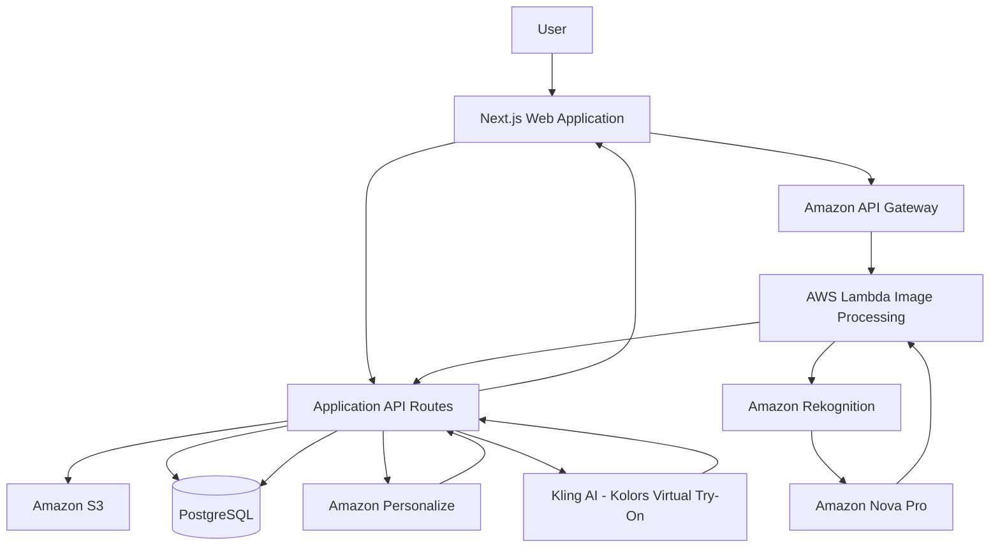
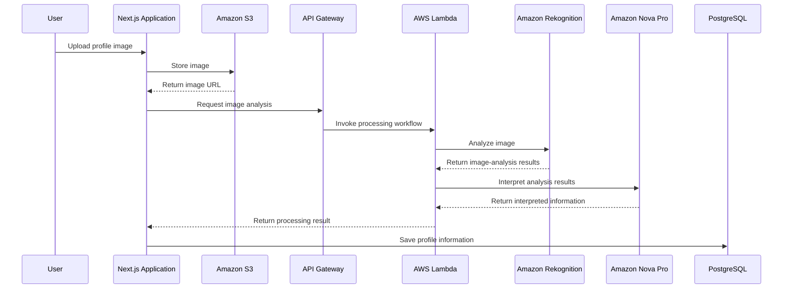
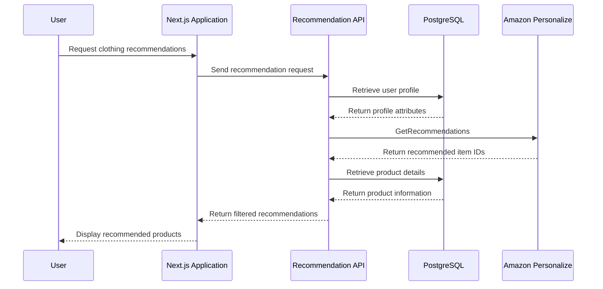
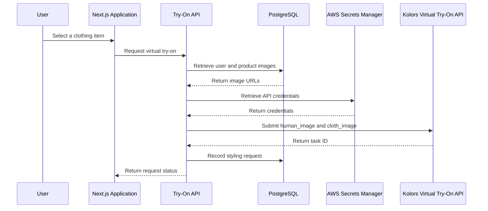

# FYUSE — AI-Powered Personalized Fashion Discovery

**FYUSE (For You Style)** is an AI-powered fashion discovery application designed to help users find clothing that better matches their personal characteristics and style preferences. It combines image-based profile analysis, personalized product recommendations, and AI virtual try-on to create a more individualized fashion discovery experience.

The project integrates a web application with AWS services and external AI APIs. Its architecture separates the frontend experience, application APIs, recommendation services, image-processing workflows, and virtual try-on generation.

> **Project status:** The application is not currently available as a live public deployment. This repository contains the web application and its application-side integrations. Some image-analysis processing was implemented through AWS Lambda and API Gateway; that Lambda source code is not included in this repository.

---

## 1. Project Overview

Traditional online fashion discovery often relies on broad product categories and manual browsing. FYUSE explores how AI can make this process more personalized by considering a user's visual characteristics, profile information, and fashion preferences.

The application brings together three main capabilities:

- **AI-assisted profile analysis:** Uses image analysis and language-model interpretation to derive fashion-relevant information from a user's uploaded image.
- **Personalized product recommendations:** Uses Amazon Personalize to retrieve clothing recommendations based on user and product attributes.
- **AI virtual try-on:** Uses the Kling AI (Kolors Virtual Try-On) API to generate an image of a user wearing a selected clothing item.

## 2. Core AI Capabilities

### 2.1 Image-Based Fashion Profile Analysis

Users can upload a personal image during profile setup. The image-analysis workflow was designed around:

1. **Amazon S3** to store the uploaded image.
2. **Amazon Rekognition** to analyze the image and obtain visual information.
3. **Amazon Nova Pro** to interpret the image-analysis results and derive fashion-relevant information.
4. **AWS Lambda**, exposed through **Amazon API Gateway**, to handle the image-processing workflow and connect the external services with the application.

The resulting profile information is intended to support more relevant fashion recommendations.

**Implementation boundary:** The Next.js repository contains the image-upload and profile-registration APIs, but does not contain the Lambda source for the Rekognition/Nova Pro processing workflow. That processing was handled outside this repository. The original AWS account is no longer accessible, so the Lambda implementation and its deployed configuration cannot currently be independently inspected.

### 2.2 Personalized Product Recommendations

FYUSE integrates **Amazon Personalize** to retrieve product recommendations.

The application sends recommendation requests using a Personalize campaign and filter values derived from the user's profile and selected product category. The current application-side recommendation route uses:

- Gender
- Clothing category
- Fashion type

The recommendation API retrieves up to 25 results from the configured campaign, applies application-side filtering against previously recommended or saved wardrobe items, and retrieves the corresponding product information from the database.

The repository also includes Personalize dataset schemas for users, items, and interactions.

### 2.3 AI Virtual Try-On

FYUSE integrates the **Kolors Virtual Try-On API** from Kling AI to generate virtual clothing previews.

The application:

1. Retrieves the user's stored image URL.
2. Retrieves the selected product's clothing image URL.
3. Sends both images to the virtual try-on API.
4. Receives a task identifier and records the styling request.
5. Uses the configured callback integration for the asynchronous generation workflow.

The API request uses the `kolors-virtual-try-on-v1-5` model and passes the user image and clothing image through the `human_image` and `cloth_image` fields.

---

## 3. System Architecture

The system combines a Next.js application, AWS-managed services, a relational database, and external AI APIs.



**Architecture note:** The diagram represents the intended application workflow, including the externally hosted Lambda image-analysis component. The Next.js application-side integrations are represented in the repository; the Lambda implementation is not included in the public source.

### Main Components

| Component | Responsibility |
|---|---|
| Next.js application | User interface, application logic, and API routes |
| Amazon S3 | Storage for uploaded user images |
| Amazon API Gateway | API entry point for the external Lambda workflow |
| AWS Lambda | Image-analysis orchestration and integration with external AWS AI services |
| Amazon Rekognition | Image analysis |
| Amazon Nova Pro | Interpretation of image-analysis results |
| Amazon Personalize | Personalized product recommendation retrieval |
| PostgreSQL | User, product, profile, and application data |
| Prisma | Database access and data modeling |
| Kling AI / Kolors API | Virtual try-on image generation |
| AWS Secrets Manager | Storage and retrieval of external service credentials |
| Amazon CloudWatch | Application and service monitoring infrastructure |

---

## 4. AI Processing Workflows

### Workflow A — User Image and Profile



The Lambda processing sequence is documented at the architecture level. Its implementation source and exact request/response contracts are not part of this repository.

### Workflow B — Personalized Product Recommendations



### Workflow C — Virtual Try-On



---

## 5. Technology Stack

| Area | Technologies |
|---|---|
| Frontend | Next.js 15, React 19, TypeScript |
| Styling and UI | Tailwind CSS, Framer Motion |
| Data visualization | Recharts |
| Client-side data fetching | SWR, Axios |
| Backend | Next.js API Routes |
| Database | PostgreSQL, Prisma ORM |
| Caching | Upstash Redis |
| Authentication | Amazon Cognito, OpenID Connect |
| Image storage | Amazon S3 |
| Image analysis | Amazon Rekognition |
| AI model interpretation | Amazon Nova Pro |
| Recommendation engine | Amazon Personalize |
| Virtual try-on | Kling AI / Kolors Virtual Try-On API |
| Serverless processing | AWS Lambda, Amazon API Gateway |
| Secrets management | AWS Secrets Manager |
| Monitoring | Amazon CloudWatch |
| Deployment infrastructure | AWS Amplify |

**Integration note:** The Rekognition, Nova Pro, Lambda, and API Gateway components belong to the external image-processing workflow. Their presence in this architecture does not mean their implementation source is contained in this repository.

---

## 6. Application Architecture

The repository follows a Next.js App Router structure. Application features are separated into page-level interfaces, reusable components, API routes, and supporting libraries.

### Repository Structure

```text
fyuse-aws/
├── amplify/
├── app/
│   ├── api/
│   │   ├── upload-image/
│   │   ├── register-profile/
│   │   ├── recommend-product/
│   │   ├── product-only/
│   │   └── tryon/
│   └── ...
├── components/
├── lib/
├── personalize-schema/
│   ├── user.json
│   ├── item.json
│   └── interaction.json
├── prisma/
├── public/
├── fetch-secrets.js
├── middleware.ts
├── next.config.mjs
├── package.json
├── package-lock.json
└── README.md
```

### Key Application APIs

| API route | Purpose |
|---|---|
| `/api/upload-image` | Uploads a user image to Amazon S3 and stores its URL in the user's profile |
| `/api/register-profile` | Registers profile information, including fashion-related attributes and the uploaded image URL |
| `/api/recommend-product` | Retrieves personalized product recommendations using Amazon Personalize |
| `/api/product-only` | Retrieves product recommendations for product discovery and records styling-related activity |
| `/api/tryon` | Submits a virtual try-on request to the Kolors API |

The image-analysis Lambda endpoint is external to the repository and is not represented as a local Next.js API route.

---

## 7. Amazon Personalize Data Model

The repository includes three dataset schemas used to define the recommendation data structure.

### User Dataset

The user schema includes fields such as:

- `USER_ID`
- `country`
- `birthdate`
- `city`
- `occupation`
- `gender`
- `skinTone`
- `bodyShape`
- `stylePreference`
- `clothingTypePreference`

### Item Dataset

The item schema includes:

- `ITEM_ID`
- `gender`
- `fashionType`
- `clothFitting`
- `clothingCategory`
- `clothingType`
- `brand`
- `color`
- `image_url`
- `product_link`
- `product_name`

### Interaction Dataset

The interaction schema includes:

- `USER_ID`
- `ITEM_ID`
- `EVENT_TYPE`
- `TIMESTAMP`

These schemas define the data structure for recommendation-related information. The current recommendation API implementation specifically uses gender, clothing category, and fashion type as Personalize filter values.

---

## 8. Local Development Setup

### Prerequisites

- Node.js 20 or later
- npm 10 or later
- Access to the required application services and credentials for the features being tested

### Installation

Clone the repository:

```bash
git clone https://github.com/Mamen014/fyuse-aws.git
cd fyuse-aws
```

Install dependencies:

```bash
npm install
```

Configure the environment variables required by the application. The application relies on external service credentials and configuration, including AWS resources, database access, and the virtual try-on API. Do not commit credentials or secret values to the repository.

Start the development server:

```bash
npm run dev
```

Open `http://localhost:3000` in your browser.

### Available Scripts

| Command | Description |
|---|---|
| `npm run dev` | Starts the local development server |
| `npm run build` | Builds the production application |
| `npm run start` | Starts the production server |
| `npm run lint` | Runs the configured linting checks |

**Important:** A successful local installation does not imply that the external AWS services or third-party APIs are available. Running the full application requires valid service configuration, credentials, and accessible backend resources.

---

## 9. Project Status and Limitations

FYUSE was developed as an integrated AI application rather than a standalone model demonstration. Its public repository provides the application code and several service integrations, while some infrastructure and processing components were deployed separately.

| Component | Status and evidence |
|---|---|
| Next.js web application | Source code included in this repository |
| User image upload | Implemented through the application API and Amazon S3 |
| Profile registration | Implemented through the application API and Prisma |
| Amazon Personalize integration | Implemented in recommendation API routes |
| Personalize dataset schemas | Included in `personalize-schema/` |
| Kolors virtual try-on integration | Implemented in `/api/tryon` |
| AWS Secrets Manager integration | Used by the application to retrieve external API credentials |
| Rekognition and Nova Pro image analysis | External Lambda workflow; source code is not included in this repository |
| API Gateway | Used to connect the application with the external Lambda workflow |
| Public deployment | No active public deployment |

The original AWS account used for the Lambda-based image-analysis workflow is no longer accessible. Consequently, the Lambda source code, deployed configuration, and exact API Gateway configuration cannot currently be provided for independent review. The repository should therefore be treated as the inspectable application-side implementation, not a complete export of every deployed cloud resource.

---

## 10. Project Contributions

The project involved designing and developing an AI-powered fashion application, integrating external AI services, and connecting the application to cloud infrastructure.

Key areas of contribution included:

- Developed the Next.js application and its user-facing fashion discovery workflows.
- Implemented application APIs for image upload, profile registration, recommendation retrieval, and virtual try-on requests.
- Integrated Amazon S3 for user image storage and Amazon Personalize for personalized product recommendations.
- Implemented the application-side integration with the Kling AI Kolors Virtual Try-On API.
- Worked with AWS Lambda and API Gateway for the external image-analysis workflow involving Amazon Rekognition and Amazon Nova Pro.
- Structured recommendation data using Amazon Personalize user, item, and interaction schemas.
- Integrated PostgreSQL and Prisma for application data management.
- Used AWS Secrets Manager for external API credential retrieval.

---

## 11. Technical References

- [Next.js Documentation](https://nextjs.org/docs)
- [Amazon Rekognition Documentation](https://docs.aws.amazon.com/rekognition/)
- [Amazon Nova Documentation](https://docs.aws.amazon.com/nova/)
- [Amazon Personalize Documentation](https://docs.aws.amazon.com/personalize/)
- [AWS Lambda Documentation](https://docs.aws.amazon.com/lambda/)
- [Amazon API Gateway Documentation](https://docs.aws.amazon.com/apigateway/)
- [Amazon S3 Documentation](https://docs.aws.amazon.com/s3/)
- [Prisma Documentation](https://www.prisma.io/docs)

---

## Repository

**GitHub:** https://github.com/Mamen014/fyuse-aws

**Project:** FYUSE — For You Style

**Category:** AI Application Development · Fashion Technology · AWS Cloud Integration · Personalized Recommendation Systems · Virtual Try-On